# Post-contenido, Unidad 9: Seguridad en Aplicaciones Web

**Estudiante:** Nicolás Andrés Sánchez Villamizar · Programación Web · Universidad de Santander (UDES)

## Descripción

Repositorio del laboratorio de la Unidad 9 de Programación Web. Contiene un único proyecto Maven Spring Boot ([`seguridad-web/`](seguridad-web)) con dos mecanismos de autenticación que conviven en la misma aplicación:

- **Sesión** (Spring Security con form-login) para las vistas Thymeleaf: login, registro, dashboard, tareas y panel de administración.
- **JWT stateless** para la API REST bajo `/api/**`.

Paquetes por capa: `config`, `controller`, `service`, `repository`, `model`, `security` y `dto`. Todas las dependencias se inyectan por constructor.

Todo lo que aparece en este README se ejecutó de verdad. Las capturas salen de GitHub Actions:

- La aplicación empaquetada corrió contra **MySQL 8.4**.
- La recorrí con **Chromium con ventana** (sobre Xvfb).
- Las capturas de terminal son **xterm reales** ejecutando `curl`, `mysql` y `./mvnw`.

Además hay **36 pruebas automáticas**, que pasan en verde con JDK 17 y con JDK 23 (ver [Pruebas automáticas](#pruebas-automáticas)).

## Parte 1: Login con sesión, BCrypt, roles y mitigación activa

### Configuración de la cadena de sesión

[`SecurityConfig`](seguridad-web/src/main/java/com/universidad/seguridad/config/SecurityConfig.java) define [`webFilterChain`](seguridad-web/src/main/java/com/universidad/seguridad/config/SecurityConfig.java#L89-L119) con `@Order(2)` y `securityMatcher("/**")`. Sus piezas:

- **Form-login** con página propia (`/login`).
- **Logout** por POST, que invalida la sesión y borra `JSESSIONID`.
- **Autorización por rol con HttpSecurity:** `/admin/**` exige `hasRole("ADMIN")` ([línea 99](seguridad-web/src/main/java/com/universidad/seguridad/config/SecurityConfig.java#L99)).
- **Autorización por rol con `@PreAuthorize`** en los servicios, como segunda barrera. En [`TareaService`](seguridad-web/src/main/java/com/universidad/seguridad/service/TareaService.java#L22-L56) un USER solo puede leer, buscar y crear sus propias tareas; en [`UsuarioService.listarTodos`](seguridad-web/src/main/java/com/universidad/seguridad/service/UsuarioService.java#L35-L38) la lista de usuarios es solo para ADMIN.
- **BCrypt con costo 12:** [`passwordEncoder()`](seguridad-web/src/main/java/com/universidad/seguridad/config/SecurityConfig.java#L30-L33). El hash se calcula al registrar ([`UsuarioService`, línea 30](seguridad-web/src/main/java/com/universidad/seguridad/service/UsuarioService.java#L30)) y todo registro nuevo queda como `ROLE_USER` ([línea 31](seguridad-web/src/main/java/com/universidad/seguridad/service/UsuarioService.java#L31)).
- **UserDetailsService con base de datos:** [`UsuarioDetailsService`](seguridad-web/src/main/java/com/universidad/seguridad/service/UsuarioDetailsService.java#L20-L29) busca el usuario por correo en MySQL y lo entrega al [`DaoAuthenticationProvider`](seguridad-web/src/main/java/com/universidad/seguridad/config/SecurityConfig.java#L35-L41).
- **CSRF activo**, que es el comportamiento por defecto ([comentario en la línea 116](seguridad-web/src/main/java/com/universidad/seguridad/config/SecurityConfig.java#L116-L117)). Thymeleaf mete el token `_csrf` en cada formulario `th:action` sin que yo tenga que hacer nada.

**Checkpoint 1.** `GET /dashboard` sin sesión redirige a `/login`. En la URL de la captura se ve `localhost:8080/login`.

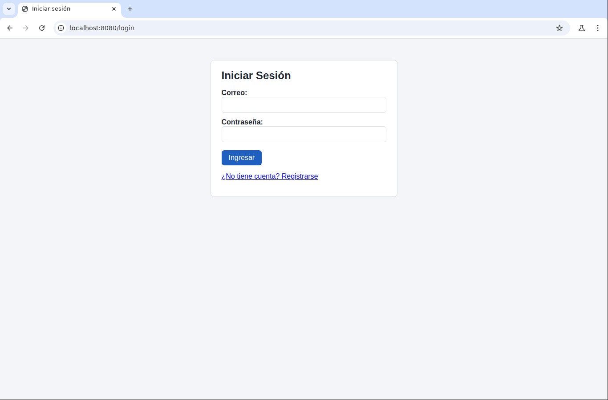

Después del registro, el formulario vuelve al login con el aviso de éxito:

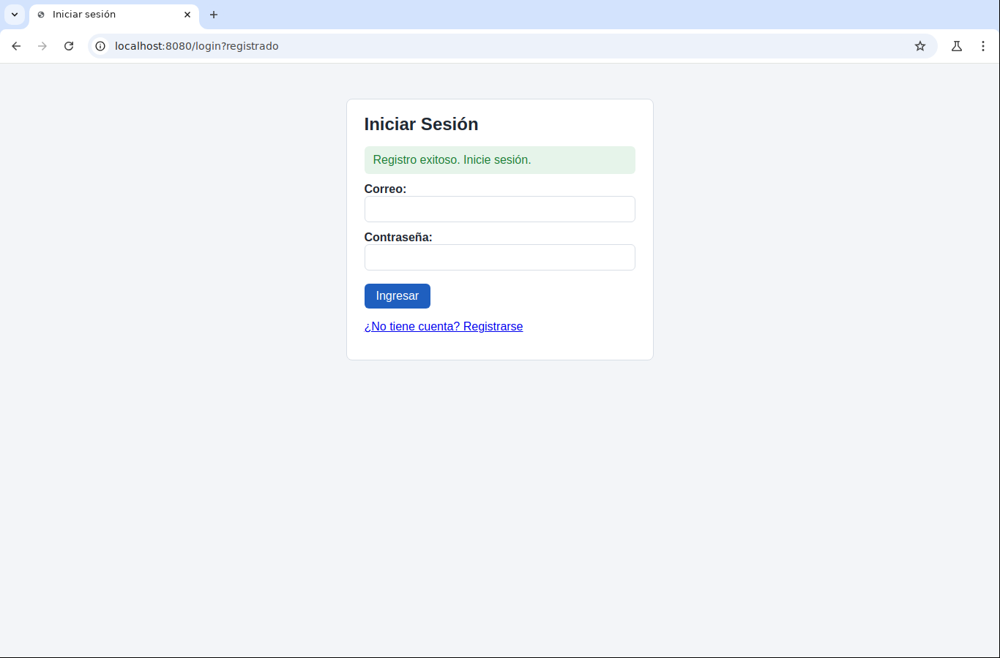

En MySQL las contraseñas quedan como hash BCrypt de costo 12: todos empiezan por `$2a$12$` y tienen 60 caracteres. El ADMIN lo inserté con el `INSERT` del Paso 8, usando el hash que genera [`GenerarHash`](seguridad-web/src/test/java/com/universidad/seguridad/GenerarHash.java) con el mismo `PasswordEncoder` de la aplicación. Los otros tres usuarios se registraron desde `/registro`.

La columna `activo` sale en blanco en la consola porque MySQL guarda el `boolean` como `BIT(1)` y el cliente imprime ese byte sin carácter visible. En `/admin` y en `/api/admin/usuarios` se ve el valor real (`Sí` / `true`).

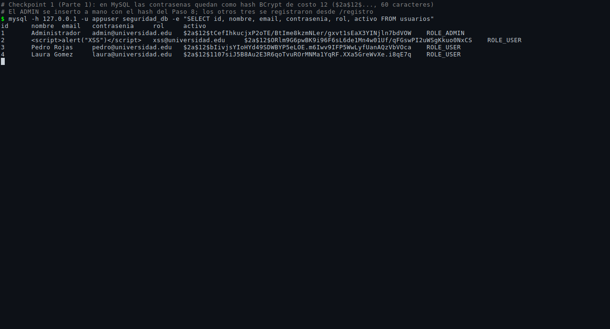

**Checkpoint 2, roles.** Con un USER, `/admin` responde **403**. Uso una página propia, [`error/403.html`](seguridad-web/src/main/resources/templates/error/403.html), en vez de la página blanca de Spring.

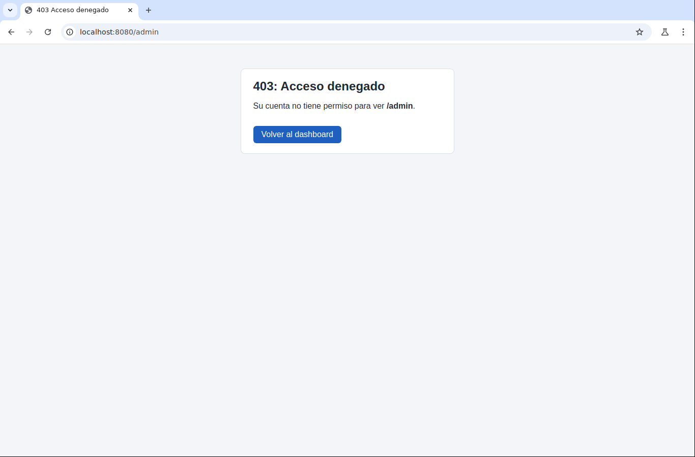

Con `admin@universidad.edu`, el dashboard muestra `ROLE_ADMIN` y el enlace al panel ([`sec:authorize`, línea 15 de `dashboard.html`](seguridad-web/src/main/resources/templates/dashboard.html#L15)). `/admin` lista los usuarios y todas las tareas:

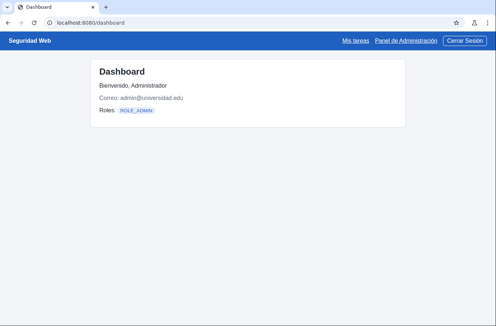

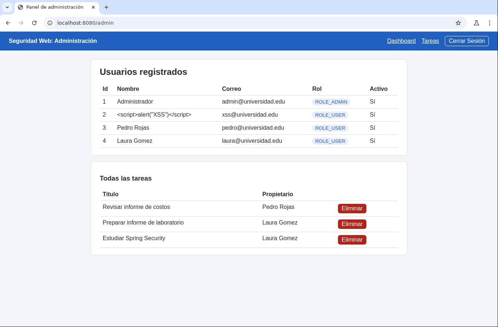

### Verificación activa de XSS: `th:text` contra `th:utext`

Registré un usuario cuyo nombre es el payload `<script>alert("XSS")</script>`. El dashboard muestra justamente el **nombre**; más abajo, en las inconsistencias, explico por qué la guía mostraba el correo.

**Con `th:text`**, que es la versión que queda en el repositorio ([línea 29 de `dashboard.html`](seguridad-web/src/main/resources/templates/dashboard.html#L29)), Thymeleaf escapa el contenido y el navegador muestra el texto literal. El HTML que recibió Chromium fue:

```html
<p>Bienvenido, <span>&lt;script&gt;alert("XSS")&lt;/script&gt;</span></p>
```

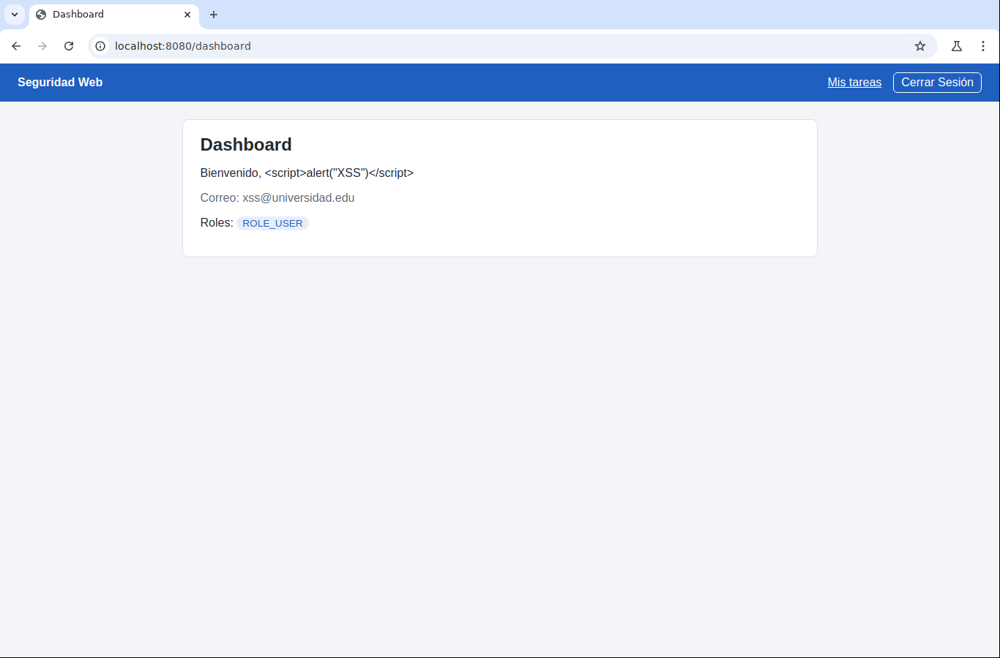

**Con `th:utext`** el resultado cambia. Hice la prueba temporal que pide la guía: activé la línea comentada ([líneas 31 a 36](seguridad-web/src/main/resources/templates/dashboard.html#L31-L36)) solo en una copia de la app que corrió en el puerto 8081. Esa línea nunca se versionó; el repositorio siempre la tuvo comentada.

Con el mismo usuario, el navegador **ejecutó el script** y apareció la alerta. Chromium muestra la alerta antes de terminar de pintar la página, por eso el fondo está vacío. El HTML de esa variante fue:

```html
<p><script>alert("XSS")</script></p>
```

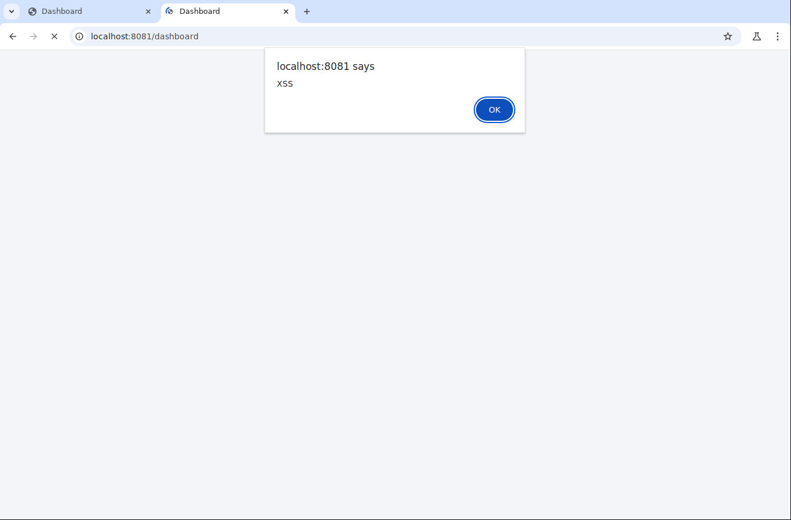

La diferencia es que `th:text` convierte `<` y `>` en entidades HTML, mientras que `th:utext` inserta el valor como marcado. Por eso todos los campos que vienen del usuario usan `th:text` en todas las vistas: nombre, correo, títulos, descripciones y el texto buscado.

### Verificación activa de SQL Injection: `@Query` parametrizado

El buscador de tareas usa [`buscarPorTitulo`](seguridad-web/src/main/java/com/universidad/seguridad/repository/TareaRepository.java#L16-L19), un `@Query` con el parámetro nombrado `:texto`. JPA lo envía como valor de un `PreparedStatement`, nunca como parte de la consulta.

Antes de la prueba, laura (USER) tiene 2 tareas, y en la base hay una tercera, privada, de Pedro:

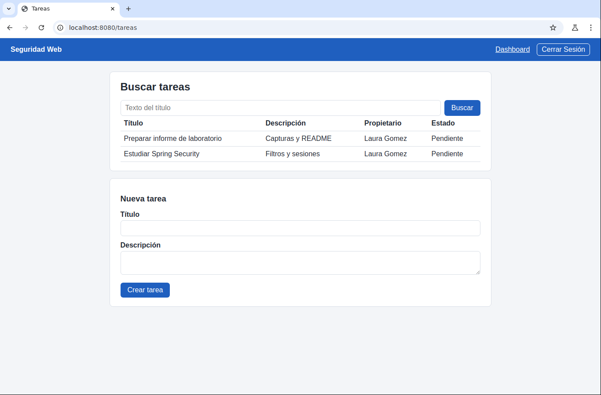

Probé la entrada `' OR '1'='1`. La búsqueda **no encontró ninguna tarea**: `Resultados para ' OR '1'='1: 0`. El texto se trató como un literal que ningún título contiene.

La primera captura es la búsqueda global del ADMIN, que es exactamente el `buscarPorTitulo` de la guía y la consulta que más tiene para perder:

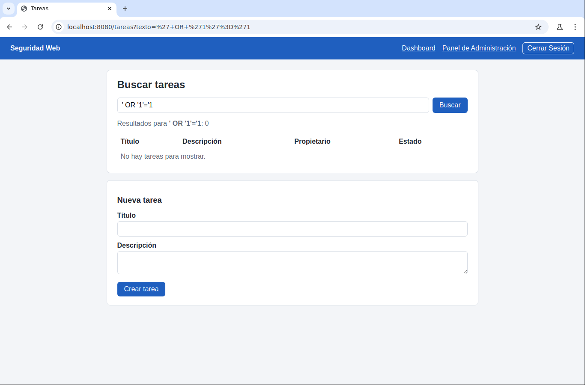

El mismo payload desde la cuenta de un USER también da 0. El USER busca con [`buscarPorTituloDe`](seguridad-web/src/main/java/com/universidad/seguridad/repository/TareaRepository.java#L21-L24), igual de parametrizado pero limitado a sus tareas:


Para descartar que el buscador simplemente no funcione, una búsqueda normal (`informe`) sí encuentra las 2 tareas de distintos usuarios que contienen esa palabra:

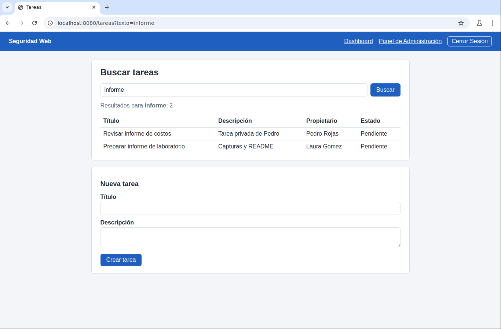

**Qué habría pasado con la versión concatenada.** La versión insegura del Paso 3 está solo como comentario ([líneas 26 a 30 de `TareaRepository`](seguridad-web/src/main/java/com/universidad/seguridad/repository/TareaRepository.java#L26-L30)). Con ese payload la consulta quedaría así:

```sql
SELECT * FROM tareas WHERE titulo LIKE '%' OR '1'='1%'
```

La condición `'1'='1'` es siempre verdadera, así que habría devuelto **las 3 tareas de todos los usuarios**, sin filtrar por título ni por dueño. En el buscador de un USER eso habría expuesto incluso la tarea privada de otro usuario.

### CSRF

**Checkpoint 3.** Todo se hizo con `curl` contra la app real:

1. `POST /logout` sin sesión y sin token responde **403**.
2. Inicié sesión como laura enviando el token del formulario y recibí 302 al dashboard.
3. Repetí el `POST /logout` con su cookie de sesión **pero sin token**, que es lo que haría un formulario de otro sitio aprovechando la cookie. También respondió **403**.
4. La sesión siguió viva: `GET /dashboard` respondió 200.
5. El logout con el token que Thymeleaf pone en el formulario del dashboard sí funcionó: 302 a `/login?logout`.

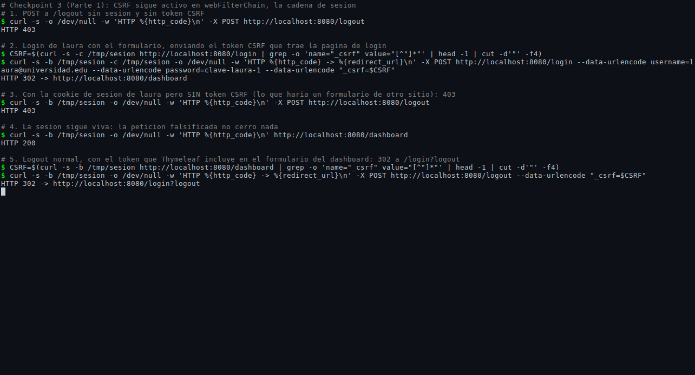

El botón **Cerrar Sesión** del dashboard hace ese mismo logout normal y termina en `/login?logout`:

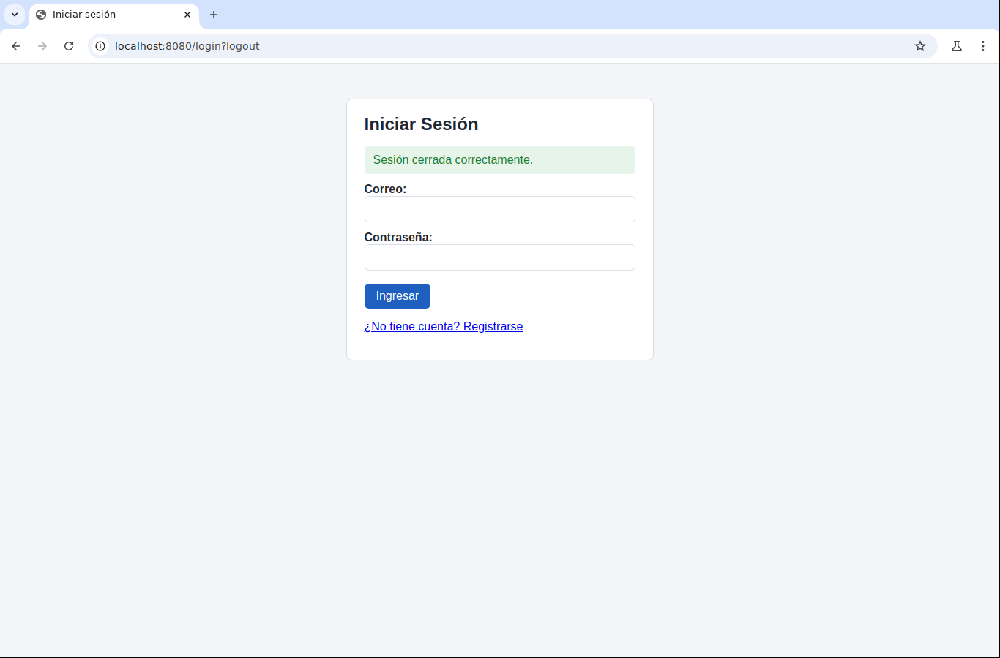

## Parte 2: API REST stateless protegida con JWT

### La cadena de la API

[`apiFilterChain`](seguridad-web/src/main/java/com/universidad/seguridad/config/SecurityConfig.java#L59-L87) tiene `@Order(1)` y `securityMatcher("/api/**")`, así que Spring Security la evalúa antes que la cadena de sesión y solo atiende `/api/**`. Sus reglas:

- `SessionCreationPolicy.STATELESS` ([líneas 69 a 71](seguridad-web/src/main/java/com/universidad/seguridad/config/SecurityConfig.java#L69-L71)): no se crea ni se usa sesión HTTP.
- CSRF desactivado **solo en esta cadena** ([línea 66](seguridad-web/src/main/java/com/universidad/seguridad/config/SecurityConfig.java#L66)). La API no usa cookies; el token va en el header `Authorization`, y un formulario de otro sitio no puede ponerlo por su cuenta.
- `/api/auth/login` es público, `/api/admin/**` exige ADMIN y el resto exige estar autenticado.
- Responde **401** en JSON cuando falta autenticación y **403** cuando el token es válido pero el rol no alcanza ([líneas 77 a 84](seguridad-web/src/main/java/com/universidad/seguridad/config/SecurityConfig.java#L77-L84)).

### Las clases de JWT

[`JwtUtil`](seguridad-web/src/main/java/com/universidad/seguridad/security/JwtUtil.java) es una clase de utilidad dedicada a generar y validar el token:

- **Genera** el token ([`generarToken`](seguridad-web/src/main/java/com/universidad/seguridad/security/JwtUtil.java#L28-L37)) con el correo como `subject` y los claims `uid` y `rol`.
- **Firma** con HMAC y pone una **expiración de 1 hora**.
- **Valida** firma y expiración en [`esValido`](seguridad-web/src/main/java/com/universidad/seguridad/security/JwtUtil.java#L51-L58). Si cualquiera de las dos falla, responde `false`.

jjwt elige el algoritmo HMAC según el largo de la clave. Con la clave de desarrollo (53 bytes) firma con **HS384**, como se ve en la cabecera decodificada de la captura.

[`JwtAuthFilter`](seguridad-web/src/main/java/com/universidad/seguridad/security/JwtAuthFilter.java) es un `OncePerRequestFilter`, en una clase separada de la configuración. En cada petición a `/api/**`:

1. Lee `Authorization: Bearer`.
2. Valida el token.
3. Puebla el `SecurityContext` a mano ([línea 41](seguridad-web/src/main/java/com/universidad/seguridad/security/JwtAuthFilter.java#L41)) con los datos del token, sin consultar la base de datos.

Si el token no es válido, no autentica y `apiFilterChain` responde 401.

[`ApiAuthController`](seguridad-web/src/main/java/com/universidad/seguridad/controller/ApiAuthController.java#L34-L53) valida las credenciales con el **mismo** `DaoAuthenticationProvider` de la Parte 1 (UsuarioDetailsService y BCrypt) y devuelve el token. Con credenciales malas responde 401 sin token y con un mensaje genérico.

**Checkpoint 1.** El login con el ADMIN de la Parte 1 devuelve el token. Lo decodifiqué ahí mismo: `{'alg': 'HS384'}` y los claims `sub`, `uid`, `rol`, `iat` y `exp`, con `exp - iat = 3600` s. Con una contraseña incorrecta responde **401** y ningún token.

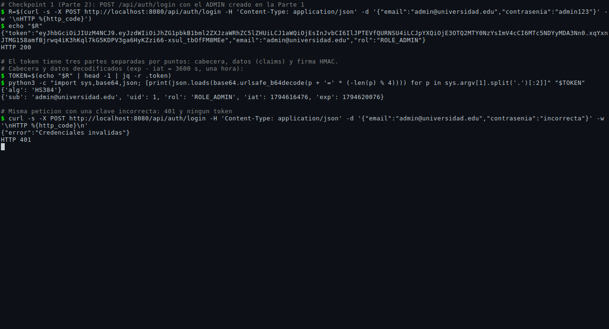

**Checkpoint 2, aceptado.** Con el token, `GET /api/tareas` responde **200**:

- El token de laura devuelve solo sus 2 tareas.
- El token del ADMIN abre `/api/admin/usuarios`.
- La API responde con DTOs ([`TareaDto`](seguridad-web/src/main/java/com/universidad/seguridad/dto/TareaDto.java), [`UsuarioDto`](seguridad-web/src/main/java/com/universidad/seguridad/dto/UsuarioDto.java)), así que nunca sale un hash de contraseña.
- Las cabeceras de la respuesta **no traen `Set-Cookie`**, porque no se creó ninguna sesión.

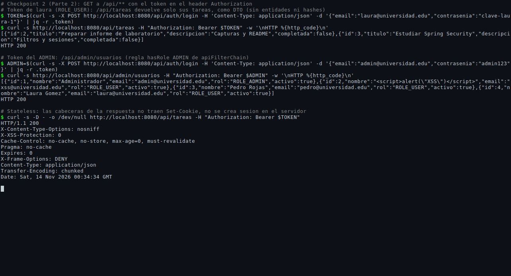

**Checkpoint 2, rechazado.** Cuatro casos contra la app real:

1. Sin header `Authorization`: **401**.
2. Con un carácter de la firma cambiado: **401**.
3. Con un **token expirado**: **401**. Lo probé de verdad sin esperar una hora. Levanté la misma aplicación (mismo jar, misma clave y misma base) en el puerto 8082 con `JWT_EXPIRACION_MS=3000`. El token que emitió fue aceptado en el 8080 recién emitido (200) y, 4 segundos después, rechazado (401).
4. El token válido de un USER contra `/api/admin/usuarios`: **403**, porque está autenticado pero no tiene el rol.

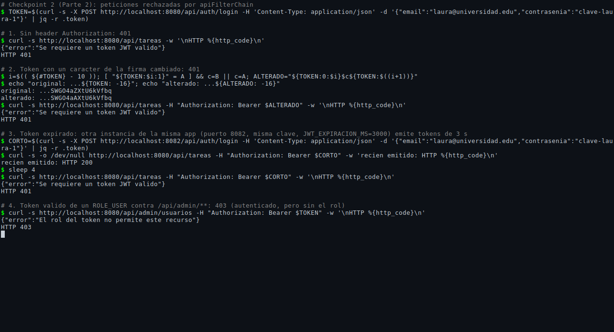

### Checkpoint 3: sesión y JWT al mismo tiempo

A la derecha está el navegador con la sesión del ADMIN abierta en `/dashboard`. A la izquierda, una xterm ejecutando toda la secuencia de `curl` contra `/api/**`.

Cuando terminaron las peticiones recargué el dashboard sin volver a iniciar sesión y siguió respondiendo con la sesión. Al mismo tiempo, la API respondió con 200, 401 y 403 según el token. Ninguna superficie afectó a la otra.

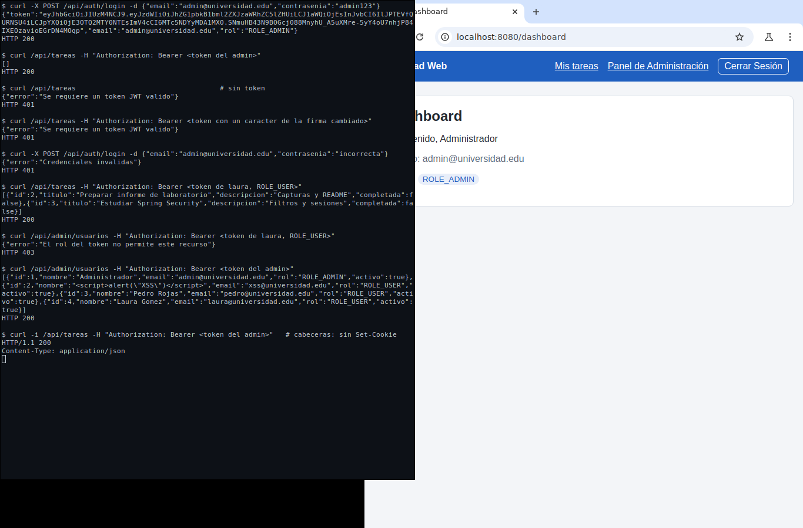

La prueba automática [`sesionYJwt_convivenSinQueUnoAutentiqueAlOtro`](seguridad-web/src/test/java/com/universidad/seguridad/ApiJwtTest.java#L138) lo comprueba en las dos direcciones:

- La cookie de sesión no abre `/api/**`.
- Un token JWT no abre `/dashboard`.

## Por qué dos mecanismos en el mismo proyecto

Las vistas Thymeleaf sirven a un **navegador** que mantiene una cookie de sesión. Ahí la sesión es el mecanismo natural: el servidor recuerda quién inició sesión y el navegador manda la cookie solo. Justamente porque el navegador la manda solo, también en peticiones que armó otro sitio, **CSRF tiene que seguir activo** en esa cadena.

La API sirve a **clientes que no son un navegador con cookies**: una app móvil, una SPA servida desde otro dominio o un servicio externo que se integra con el sistema. Esos clientes no pueden depender de una sesión guardada en el servidor. Necesitan una credencial autocontenida que viaje en cada petición, y eso es el token JWT en el header `Authorization`. Como el token no se envía automáticamente, CSRF no aplica en esa cadena y se desactiva solo ahí.

Ningún mecanismo reemplaza al otro. Cada uno cubre un tipo de cliente distinto del mismo sistema, y por eso son dos `SecurityFilterChain` independientes:

| | Sesión (`webFilterChain`) | JWT (`apiFilterChain`) |
|---|---|---|
| Prioridad | `@Order(2)`, `/**` | `@Order(1)`, `/api/**` |
| Credencial | Cookie `JSESSIONID` | Header `Authorization: Bearer` |
| Estado en el servidor | Sí (sesión HTTP) | No (`STATELESS`) |
| CSRF | Activo | Desactivado (no hay cookie) |
| Sin credencial | 302 a `/login` | 401 en JSON |
| Rol insuficiente | 403 (página `error/403`) | 403 en JSON |
| Cliente | Navegador con vistas Thymeleaf | App móvil, SPA, otro servicio |

Hay algo que comparten a propósito: el usuario autenticado. [`UsuarioAutenticado`](seguridad-web/src/main/java/com/universidad/seguridad/security/UsuarioAutenticado.java) lleva id, nombre, correo y rol. Lo arman tanto [`UsuarioDetailsService`](seguridad-web/src/main/java/com/universidad/seguridad/service/UsuarioDetailsService.java#L27-L28) (sesión) como [`JwtAuthFilter`](seguridad-web/src/main/java/com/universidad/seguridad/security/JwtAuthFilter.java#L35-L36) (token). Así, el mismo `@PreAuthorize("... #usuarioId == authentication.principal.id")` de [`TareaService`](seguridad-web/src/main/java/com/universidad/seguridad/service/TareaService.java#L24) funciona sin saber por cuál mecanismo entró el usuario.

## Nota de seguridad para producción

La guía deja la clave HMAC hardcodeada en `JwtUtil` y lo advierte en esta sección. Yo no la dejé en el código: [`JwtUtil`](seguridad-web/src/main/java/com/universidad/seguridad/security/JwtUtil.java#L22-L26) recibe la clave y la expiración desde [`application.properties`](seguridad-web/src/main/resources/application.properties#L10-L13), que a su vez las lee de las variables de entorno `JWT_SECRET` y `JWT_EXPIRACION_MS`. Lo mismo hice con la conexión a MySQL (`DB_URL`, `DB_USERNAME`, `DB_PASSWORD`).

El valor por defecto de `jwt.secret` existe solo para que el laboratorio arranque en local sin configurar nada. En producción `JWT_SECRET` tiene que venir de una variable de entorno o de un gestor de secretos, y ser larga y aleatoria. La prueba del token expirado demuestra por qué: la instancia del puerto 8082 firmó tokens que el 8080 aceptó solo porque compartían la clave. Cualquiera que conozca la clave puede firmar tokens válidos con el rol que quiera. Si la clave quedara expuesta en el repositorio, la API quedaría abierta.

## Inconsistencias del enunciado y cómo las resolví

Al ejecutar la guía tal cual encontré varios problemas. Los corregí sin cambiar lo que pide cada checkpoint:

| # | En la guía | Problema | Cómo lo resolví |
|---|---|---|---|
| 1 | `@PreAuthorize("... #usuarioId == authentication.principal.id")` con el `User` de Spring | El `User` de Spring no tiene `id`: la expresión falla para todo USER | Principal propio [`UsuarioAutenticado`](seguridad-web/src/main/java/com/universidad/seguridad/security/UsuarioAutenticado.java) con id y nombre, usado por la sesión y por el JWT (claim `uid`) |
| 2 | El dashboard muestra `auth.getName()` | Eso es el **correo**, no el nombre donde se escribe el payload de XSS: la prueba no demostraba nada | El dashboard muestra el **nombre** ([`AuthController`, línea 61](seguridad-web/src/main/java/com/universidad/seguridad/controller/AuthController.java#L61)) |
| 3 | `ApiAuthController` inyecta un `AuthenticationManager` | Spring Boot no publica ese bean: la app no arranca | Bean [`authenticationManager`](seguridad-web/src/main/java/com/universidad/seguridad/config/SecurityConfig.java#L43-L48) sobre el mismo `DaoAuthenticationProvider` |
| 4 | "Sin token: 401" | Sin un `AuthenticationEntryPoint`, Spring Security responde **403** a `/api/**` sin token | Entry point que responde 401 en JSON y 403 solo por rol ([líneas 77 a 84](seguridad-web/src/main/java/com/universidad/seguridad/config/SecurityConfig.java#L77-L84)) |
| 5 | `JwtAuthFilter` como `@Component` | Spring Boot registra todo `Filter` como filtro global del servidor: correría también en las rutas de sesión | [`FilterRegistrationBean`](seguridad-web/src/main/java/com/universidad/seguridad/config/SecurityConfig.java#L50-L57) desactivado: el filtro solo corre dentro de `apiFilterChain` |
| 6 | `/api/tareas` devuelve la entidad `Tarea` | La entidad trae su `Usuario` con el hash BCrypt: la API filtraría contraseñas | DTOs [`TareaDto`](seguridad-web/src/main/java/com/universidad/seguridad/dto/TareaDto.java) y [`UsuarioDto`](seguridad-web/src/main/java/com/universidad/seguridad/dto/UsuarioDto.java) |
| 7 | El registro recibe la entidad `Usuario` con `@ModelAttribute` | Mass assignment: alguien podría enviar `rol=ROLE_ADMIN` en el POST | Formulario [`RegistroForm`](seguridad-web/src/main/java/com/universidad/seguridad/dto/RegistroForm.java) sin id, rol ni activo (con prueba automática) |
| 8 | Clave JWT hardcodeada en `JwtUtil` | La rúbrica (Estilo, nivel Excelente) pide que viva en properties o en variable de entorno | `jwt.secret=${JWT_SECRET:...}` (ver la nota de seguridad) |
| 9 | Buscador sobre `buscarPorTitulo` para cualquier usuario | Un USER encontraría tareas de otros usuarios | ADMIN busca en todas; USER con [`buscarPorTituloDe`](seguridad-web/src/main/java/com/universidad/seguridad/repository/TareaRepository.java#L21-L24), igual de parametrizado |
| 10 | Se pide probar el buscador, el registro y `/admin` | La guía no trae la vista de tareas, la de registro ni el panel, ni la ruta `/` | Vistas [`tareas/lista`](seguridad-web/src/main/resources/templates/tareas/lista.html), [`auth/registro`](seguridad-web/src/main/resources/templates/auth/registro.html), [`admin/panel`](seguridad-web/src/main/resources/templates/admin/panel.html), [`error/403`](seguridad-web/src/main/resources/templates/error/403.html) y `/` que redirige al dashboard |
| 11 | Los `git add` de la guía | Agregan carpetas por capa, pero nunca la clase principal `SeguridadApplication` ni `.gitignore`: el repositorio quedaría sin la clase que arranca la app | Los incluí en el primer commit; cada uno de los 6 commits de la guía compila por sí solo (verificado en CI) |
| 12 | Hash del ADMIN con una clase de prueba | Una prueba con `@SpringBootTest` necesitaría MySQL corriendo para arrancar | Las pruebas usan H2 en modo MySQL. [`GenerarHash`](seguridad-web/src/test/java/com/universidad/seguridad/GenerarHash.java) no termina en `Test` y solo corre con `-Dtest=GenerarHash` |
| 13 | `./mvnw spring-boot:run` | El ZIP de Initializr trae `mvnw` y `.mvn/`, pero los `git add` de la guía nunca los versionan: quien clone el repositorio no tendría `./mvnw` | Agregué el Maven Wrapper oficial 3.3.4 en `seguridad-web/` |
| 14 | Spring Boot 3.2 con su `maven-compiler-plugin` 3.11.0 | Falla al compilar con JDK 23 | `maven-compiler-plugin` 3.13.0 en el [`pom.xml`](seguridad-web/pom.xml#L19-L23) |
| 15 | Repositorio `apellido-post1-u9` | | `sanchez-post1-u9-pweb`, con el sufijo que uso para distinguir las materias |

## Pruebas automáticas

36 pruebas con MockMvc y `spring-security-test`, sobre H2 en modo MySQL. Pasan con JDK 17 y con JDK 23; la captura es `./mvnw test` ejecutado en una terminal real:

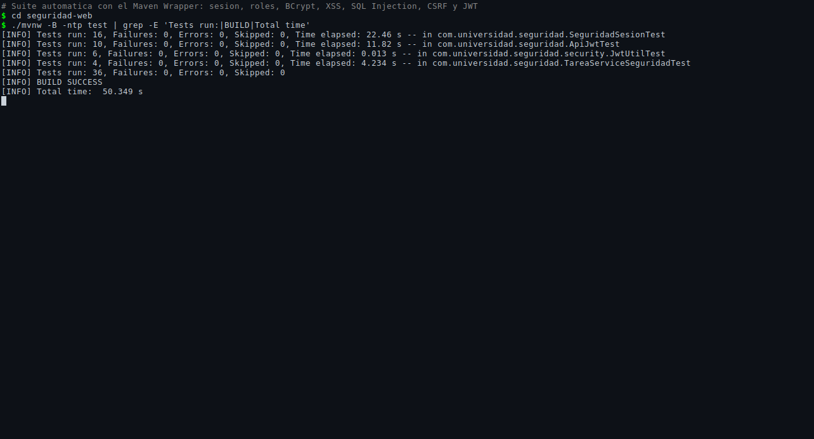

| Clase | Pruebas | Qué cubre |
|---|---|---|
| [`SeguridadSesionTest`](seguridad-web/src/test/java/com/universidad/seguridad/SeguridadSesionTest.java) | 16 | Redirección a `/login`, hash `$2a$12$` al registrar, mass assignment ignorado, correo repetido, login bueno y malo, `/admin` con USER (403) y ADMIN, enlace de admin solo para ADMIN, XSS escapado, payload de SQL Injection sin resultados, búsqueda por rol, logout sin token CSRF (403) y con token, crear tarea sin token (403) |
| [`TareaServiceSeguridadTest`](seguridad-web/src/test/java/com/universidad/seguridad/TareaServiceSeguridadTest.java) | 4 | `@PreAuthorize` en el servicio: USER con sus tareas, USER con tareas ajenas (denegado), ADMIN con tareas ajenas, lista de usuarios solo ADMIN |
| [`JwtUtilTest`](seguridad-web/src/test/java/com/universidad/seguridad/security/JwtUtilTest.java) | 6 | Claims del token, firma alterada, rol cambiado en el payload, token expirado, otra clave, texto que no es token |
| [`ApiJwtTest`](seguridad-web/src/test/java/com/universidad/seguridad/ApiJwtTest.java) | 10 | Login con token y con clave mala (401), tareas con token y sin hashes, sin token (401), firma modificada (401), expirado (401), USER en `/api/admin` (403), ADMIN en `/api/admin`, sin sesión ni cookie, convivencia en ambos sentidos |

## Cómo compilar y ejecutar

1. Clonar el repositorio: `git clone https://github.com/NicolasSnchz/sanchez-post1-u9-pweb.git`
2. Tener MySQL corriendo. La URL por defecto ya incluye `createDatabaseIfNotExist=true`, así que `seguridad_db` se crea sola si el usuario tiene permiso; si no, crearla con `CREATE DATABASE seguridad_db;`.
3. Dar las credenciales de MySQL con las variables `DB_USERNAME` y `DB_PASSWORD` (y `DB_URL` si no es `localhost:3306`), o editando [`application.properties`](seguridad-web/src/main/resources/application.properties).
4. Arrancar una vez para que Hibernate cree las tablas, generar el hash del ADMIN con `./mvnw test -Dtest=GenerarHash` e insertarlo como en el Paso 8 de la Parte 1:
   ```sql
   INSERT INTO usuarios (nombre, email, contrasenia, rol, activo)
   VALUES ('Administrador', 'admin@universidad.edu', '$2a$12$...', 'ROLE_ADMIN', 1);
   ```
5. Dentro de `seguridad-web/`, ejecutar `./mvnw spring-boot:run` (en Windows, `mvnw.cmd spring-boot:run`).
6. Vistas web: http://localhost:8080/login
7. API: `POST http://localhost:8080/api/auth/login` con `{"email": "...", "contrasenia": "..."}` y luego `Authorization: Bearer <token>` en `/api/tareas`.

Pruebas: `./mvnw clean verify` dentro de `seguridad-web/` (no necesitan MySQL).

## Historial de commits

Los 6 commits de la guía, con sus mensajes, y cada uno compila por sí solo:

1. `feat: proyecto Spring Boot con dependencias de Spring Security (parte 1)`
2. `feat: entidades Usuario/Tarea, repositorios con @Query parametrizado y servicios con BCrypt (parte 1)`
3. `feat: SecurityConfig con sesion, AuthController y vistas de login/dashboard con roles (parte 1)`
4. `feat: agregar dependencia jjwt para autenticacion JWT (parte 2)`
5. `feat: JwtUtil y JwtAuthFilter para validar tokens en cada peticion (parte 2)`
6. `feat: apiFilterChain stateless y endpoints REST protegidos con JWT (parte 2)`

Después vienen tres commits más:

- Un flujo temporal de GitHub Actions (`ci:`) que levantó la aplicación con MySQL y el navegador para tomar las capturas. Lo retiré cuando las capturas quedaron en el repositorio.
- El Maven Wrapper.
- Este README con las capturas.
